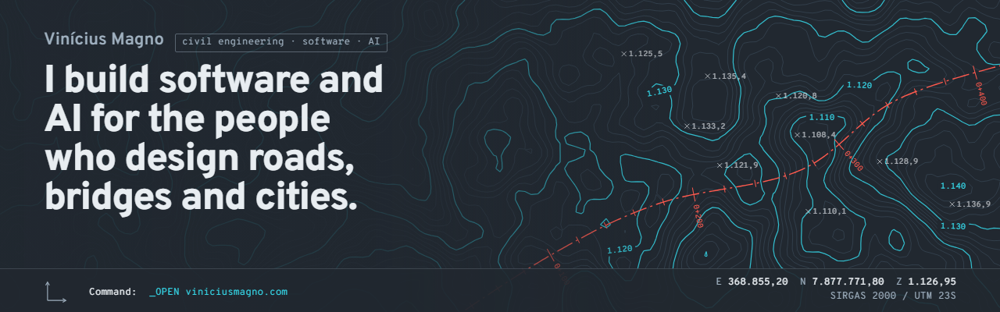

Civil engineer (UFV) turned AI & software engineer. I build production systems for infrastructure engineering: tool-use agents, RAG, MCP servers, computer vision and FastAPI + React platforms, from the DWG file to the deploy.

- **Now:** AI / Software Engineer at Manta Associados, an infrastructure engineering consultancy. I designed and run Manta Hub, a 17-microservice platform with 15 engineering tools.
- **On the side:** Topovia Civil, an AI assistant that works inside Autodesk Civil 3D through a C# MCP server.
- **Before:** a production Delphi ERP with heavy SQL at Realtec; property records, GIS and drone surveys at a city hall.

**Portfolio** [viniciusmagno.com](https://viniciusmagno.com/en/) &nbsp;·&nbsp; **LinkedIn** [in/vinicius-magno](https://www.linkedin.com/in/vinicius-magno/) &nbsp;·&nbsp; **Email** [viniciusmagnosp@gmail.com](mailto:viniciusmagnosp@gmail.com)

### Bill of quantities

Measured from the code and the projects’ own records, November 2026.

| Item | Description | Unit | Qty |
|:--:|:--|:--:|--:|
| 01 | Engineering tools on the Manta Hub platform | ea | **15** |
| 02 | FastAPI microservices running in production | ea | **17** |
| 03 | Automated tests on Manta Hub | ea | **1,230** |
| 04 | MCP servers in production | ea | **5** |
| 05 | Road video frames processed by computer vision | ea | **27,697** |
| 06 | PDF ↔ DWG sheet pairs in the conversion benchmark | ea | **607** |
| 07 | Release requests automated on a Delphi ERP | ea | **383** |
| 08 | Brazilian Math Olympiad (OBMEP) medals | ea | **4** |

### Selected work

Most of this lives in private company and client repositories. Architecture diagrams and numbers are on the [portfolio](https://viniciusmagno.com/en/#projects).

Colors follow CAD layers: 🟦 AI & LLM &nbsp; 🟪 computer vision &nbsp; 🟩 platform & backend &nbsp; 🟨 engineering, CAD & geo &nbsp; 🟥 automation

| | Project | What it does | Stack |
|:--:|:--|:--|:--|
| 🟩 | [**Manta Hub**](https://viniciusmagno.com/en/#p-manta-hub) | 15 engineering tools (earthworks, paving, bridges, BIM/IFC, budgeting, FEM) on 17 FastAPI services and a React 19 SPA | Python, FastAPI, React, Three.js |
| 🟦 | [**AskCAD**](https://viniciusmagno.com/en/#p-askcad) | Agent that answers plain-language questions about DWG/DXF drawings with 15+ tools, local RAG and a USD budget per conversation | Claude API, tool use, SSE |
| 🟦 | [**Topovia Civil**](https://viniciusmagno.com/en/#p-topovia) | Claude inside Civil 3D: 47 typed actions, always propose → approve → apply → undo; own geometry engine validated against Civil 3D | C# / .NET 8, MCP, Python |
| 🟪 | [**Pavement inspection**](https://viniciusmagno.com/en/#p-road) | Phone video + GPS over WebSocket, GPU detection and a ranked report of critical 100 m segments; 3-architecture benchmark | PyTorch, YOLO, MMDetection |
| 🟨 | [**PDF → DWG**](https://viniciusmagno.com/en/#p-pdf2dwg) | Rebuilds layered, georeferenced DXF from vector PDFs; beats AutoCAD 2026 PDFIMPORT on the sheets compared | PyMuPDF, ezdxf, scikit-learn |
| 🟩 | [**MantaBase**](https://viniciusmagno.com/en/#p-mantabase) | Multi-tenant PostgreSQL database-as-a-service with an OAuth 2.1 server written from scratch | FastAPI, asyncpg, PostgreSQL |
| 🟦 | [**MCP servers**](https://viniciusmagno.com/en/#p-mcp) | SharePoint (18 tools, Entra ID On-Behalf-Of), Postgres, the engineering platform, Civil 3D and an office system, all under the user’s own permissions | FastMCP, Microsoft Graph |
| 🟨 | [**Water-permit engine**](https://viniciusmagno.com/en/#p-nature) | Walks the drainage network upstream from any point in Minas Gerais over 292,386 permit records | GeoPandas, Shapely, Streamlit |
| 🟥 | [**EXE-bot**](https://viniciusmagno.com/en/#p-exebot) | Custom CI/CD for a Delphi ERP: Jira → cherry-pick → MSBuild → Teams; 383 requests in 7 weeks | Python, Flask, Git |
| 🟪 | [**Lot vectorization**](https://viniciusmagno.com/en/#projects) | Drone orthomosaic → georeferenced lot polygons, using the CAD cadastre as labels; 96.5 % mask mAP@50 (research) | YOLOv8-seg, rasterio, GeoPandas |

### Layer manager

● in production &nbsp; ◐ used in a project &nbsp; ○ studied only

| Layer | Items |
|:--|:--|
| 🟦 AI & LLM | ● Claude API ● OpenAI API ● tool-use agents ● MCP ● RAG ● hybrid search (BM25 + pgvector) ● prompt caching ◐ LangGraph ○ LangChain |
| 🟪 Vision & ML | ● PyTorch ● YOLO ● MMDetection ● OpenCV ● CUDA ◐ instance segmentation ◐ OCR ○ TensorFlow |
| 🟩 Backend & data | ● Python ● FastAPI ● PostgreSQL ● SQLite ● OAuth 2.1 ● C# / .NET ● Delphi ● Firebird ● Node.js ◐ Rust |
| 🟩 Frontend | ● React ● TypeScript ● Three.js ● Canvas 2D ● Vite ● Tailwind |
| 🟥 Infra & automation | ● Docker ● Linux VPS ● nginx / Caddy ● systemd ● Vercel / Netlify ● MSBuild ● Jira API ○ Kubernetes |
| 🟨 Engineering, CAD & geo | ● ezdxf ● LandXML ● IFC ● Civil 3D API ● Shapely / SciPy ● QGIS ● Metashape ● drone photogrammetry |

<b>Em português</b>

 

Engenheiro civil pela UFV que virou engenheiro de software e IA. Construo sistemas em produção para engenharia de infraestrutura: agentes com tool use, RAG, servidores MCP, visão computacional e plataformas FastAPI + React, do arquivo DWG ao deploy.

Hoje sou engenheiro de software e IA na Manta Associados, onde concebi e opero o Manta Hub (17 microsserviços, 15 ferramentas de engenharia). Por fora, desenvolvo o Topovia Civil, um assistente de IA que trabalha dentro do Civil 3D. Antes, mantive um ERP Delphi em produção na Realtec e coordenei o cadastro imobiliário de uma prefeitura, com geoprocessamento e voos de drone.

Quase todo o código é privado (empresa e clientes); a arquitetura e os números estão em **[viniciusmagno.com](https://viniciusmagno.com)**.

The banner is drawn by the same terrain engine as viniciusmagno.com: Perlin noise → marching squares → contour lines every 2 m, with a road centerline and stations.
